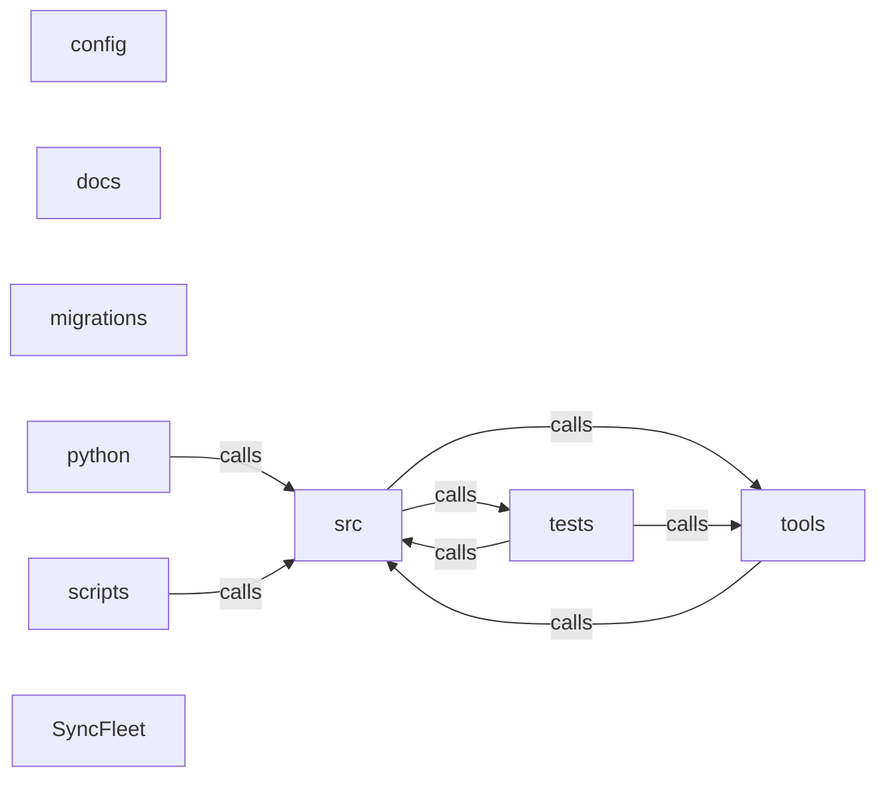

_Generated by CodeAtlas._

## Details

Architecture map of SyncFleet.

### config

Owns 0 symbols across 1 file(s).

**Related Classes/Methods:** _None_

### docs

Owns 0 symbols across 9 file(s).

**Related Classes/Methods:** _None_

### migrations

Owns 0 symbols across 3 file(s).

**Related Classes/Methods:** _None_

### python

Owns 0 symbols across 0 file(s).

**Related Classes/Methods:** _None_

### scripts

Owns 11 symbols across 2 file(s).

**Related Classes/Methods:** _None_

**Source Files:**

- `scripts/build_vendor.py`
  - `scripts.build_vendor.build_binary`
  - `scripts.build_vendor.build_wheel`
  - `scripts.build_vendor.main`
  - `scripts.build_vendor.vendor`
- `scripts/release.py`
  - `scripts.release.bump`
  - `scripts.release.git`
  - `scripts.release.main`
  - `scripts.release.read_cargo_version`
  - `scripts.release.write_cargo`
  - `scripts.release.write_changelog`
  - `scripts.release.write_init`

### src

Owns 11 symbols across 3 file(s).

**Related Classes/Methods:** _None_

**Source Files:**

- `src/main.rs`
  - `src.main.main`
- `src/sync_loop.rs`
  - `src.sync_loop.SyncLoopHandle`
  - `src.sync_loop.SyncLoopHandle.peer_count`
  - `src.sync_loop.SyncLoopHandle.shutdown`
  - `src.sync_loop.SyncLoopOptions`
  - `src.sync_loop.attempt`
  - `src.sync_loop.authorized_peer_ids`
  - `src.sync_loop.run_peer`
  - `src.sync_loop.spawn_peer`
  - `src.sync_loop.spawn_sync_loop`
  - `src.sync_loop.spawn_sync_loop_with_updates`

### tests

Owns 77 symbols across 7 file(s).

**Related Classes/Methods:** _None_

**Source Files:**

- `tests/cli.rs`
  - `tests.cli.cmd`
  - `tests.cli.commands_before_init_fail_helpfully`
  - `tests.cli.config_show_reflects_env_override`
  - `tests.cli.dataset_lifecycle`
  - `tests.cli.doctor_full_and_repair`
  - `tests.cli.init_generates_tls_material`
  - `tests.cli.init_then_status_and_doctor`
  - `tests.cli.journal_stats_and_compact_dry_run`
  - `tests.cli.peer_import_cert_rejects_invalid_file`
  - `tests.cli.peer_pair_and_revoke`
  - `tests.cli.peer_token_redeem_and_import_cert_flow`
  - `tests.cli.peer_token_requires_registered_dataset`
- `tests/identity.rs`
  - `tests.identity.enrollment_tokens_are_valid_then_expire_on_use`
  - `tests.identity.generates_stable_identity_and_node_id`
  - `tests.identity.passphrase_encrypts_keys_and_roundtrips`
  - `tests.identity.save_and_load_roundtrip`
  - `tests.identity.sign_and_verify_roundtrip`
- `tests/net.rs`
  - `tests.net.Harness`
  - `tests.net.TestNode`
  - `tests.net.harness`
  - `tests.net.hello`
  - `tests.net.hello_node_id_mismatch_is_rejected`
  - `tests.net.mutual_tls_authorized_exchange`
  - `tests.net.pin`
  - `tests.net.setup_node`
  - `tests.net.unauthorized_peer_is_rejected`
  - `tests.net.unpinned_server_cert_fails_handshake`
- `tests/replication.rs`
  - `tests.replication.Harness`
  - `tests.replication.TestNode`
  - `tests.replication.background_loop_converges_without_manual_sync`
  - `tests.replication.background_loop_survives_unreachable_peer`
  - `tests.replication.bidirectional_incremental_replication`
  - `tests.replication.bootstrap_transfers_all_batches_in_one_session`
  - `tests.replication.client_connector`
  - `tests.replication.dynamically_supplied_peer_is_synced`
  - `tests.replication.harness`
  - `tests.replication.hello`
  - `tests.replication.loop_opts`
  - `tests.replication.multi_batch_push_in_one_session`
  - `tests.replication.multiple_operations_transfer_in_order`
  - `tests.replication.pin`
  - `tests.replication.read_only_peer_cannot_push`
  - `tests.replication.register_dataset`
  - `tests.replication.setup_node`
  - `tests.replication.start_server`
  - `tests.replication.state_survives_restart`
  - `tests.replication.sync`
  - `tests.replication.sync_with`
  - `tests.replication.write`
- `tests/storage.rs`
  - `tests.storage.apply_remote_operation_advances_checkpoint_monotonically`
  - `tests.storage.apply_remote_operation_dedupes_and_advances_checkpoint`
  - `tests.storage.apply_remote_operation_rejects_bad_checksum`
  - `tests.storage.apply_remote_operation_requires_registered_dataset`
  - `tests.storage.block_on`
  - `tests.storage.compaction_respects_peer_checkpoints`
  - `tests.storage.dataset_registration_and_listing`
  - `tests.storage.failed_local_append_does_not_consume_sequence`
  - `tests.storage.integrity_check_and_wal_checkpoint_succeed`
  - `tests.storage.local_append_allocates_gap_free_sequences`
  - `tests.storage.migrations_apply_and_health_check_passes`
  - `tests.storage.operation_journal_append_and_dedupe`
  - `tests.storage.peer_authorization_lifecycle`
  - `tests.storage.register_orders`
  - `tests.storage.remote_op`
- `tests/test_codeatlas_adapter.py`
  - `tests.test_codeatlas_adapter._run`
  - `tests.test_codeatlas_adapter.test_check_reports_the_embedded_engine_available`
  - `tests.test_codeatlas_adapter.test_diagnose_summarises_the_architecture_map`
  - `tests.test_codeatlas_adapter.test_explain_reports_an_unknown_node_as_an_error`
  - `tests.test_codeatlas_adapter.test_god_nodes_are_ranked_by_degree`
- `tests/tls.rs`
  - `tests.tls.cert_generate_parse_and_node_id_roundtrip`
  - `tests.tls.enrollment_parse_rejects_bad_prefix`
  - `tests.tls.enrollment_token_expiry_is_rejected`
  - `tests.tls.enrollment_token_sign_and_verify`
  - `tests.tls.enrollment_token_tamper_is_rejected`
  - `tests.tls.make_node`
  - `tests.tls.signing_key`
  - `tests.tls.trust_store_add_load_contains_remove`

### tools

Owns 0 symbols across 0 file(s).

**Related Classes/Methods:** _None_

### SyncFleet

Owns 4 symbols across 11 file(s).

**Related Classes/Methods:** _None_

**Source Files:**

- `setup.py`
  - `setup.BinaryDistribution`
  - `setup.BinaryDistribution.has_ext_modules`
  - `setup.PlatformWheel`
  - `setup.PlatformWheel.get_tag`
