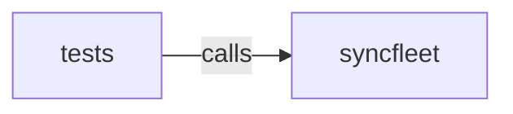

_Generated by CodeAtlas._

## Details

Owns 0 symbols across 0 file(s).

### syncfleet

Owns 6 symbols across 4 file(s).

**Related Classes/Methods:** _None_

**Source Files:**

- `python/syncfleet/cli.py`
  - `python.syncfleet.cli._bundled_binary`
  - `python.syncfleet.cli._is_executable`
  - `python.syncfleet.cli._self_paths`
  - `python.syncfleet.cli.binary_name`
  - `python.syncfleet.cli.find_binary`
  - `python.syncfleet.cli.main`

### tests

Owns 7 symbols across 1 file(s).

**Related Classes/Methods:** _None_

**Source Files:**

- `python/tests/test_wrapper.py`
  - `python.tests.test_wrapper.FindBinaryTests`
  - `python.tests.test_wrapper.FindBinaryTests.test_bundled_binary_is_used`
  - `python.tests.test_wrapper.FindBinaryTests.test_env_override_missing_is_reported`
  - `python.tests.test_wrapper.FindBinaryTests.test_env_override_wins`
  - `python.tests.test_wrapper.FindBinaryTests.test_nothing_found_raises`
  - `python.tests.test_wrapper.FindBinaryTests.test_path_lookup_skips_wrapper_itself`
  - `python.tests.test_wrapper._make_executable`
