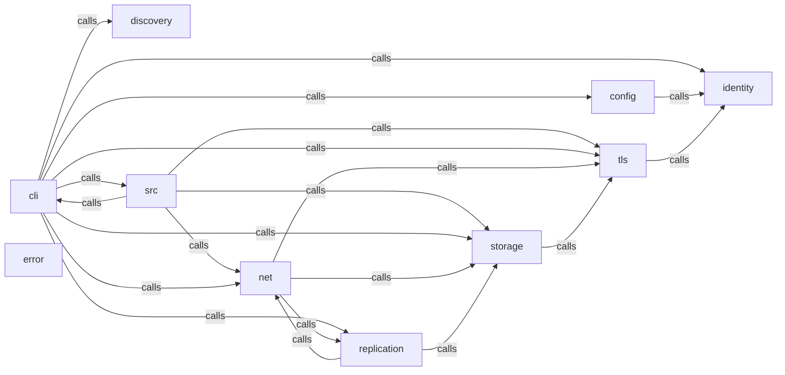

_Generated by CodeAtlas._

## Details

Owns 11 symbols across 3 file(s).

### cli

Owns 48 symbols across 1 file(s).

**Related Classes/Methods:** _None_

**Source Files:**

- `src/cli/mod.rs`
  - `src.cli.mod.ApplyDatasetArgs`
  - `src.cli.mod.Cli`
  - `src.cli.mod.Commands`
  - `src.cli.mod.ConfigAction`
  - `src.cli.mod.ConfigArgs`
  - `src.cli.mod.ConflictAction`
  - `src.cli.mod.ConflictArgs`
  - `src.cli.mod.DaemonAction`
  - `src.cli.mod.DaemonArgs`
  - `src.cli.mod.DatasetAction`
  - `src.cli.mod.DatasetArgs`
  - `src.cli.mod.DoctorArgs`
  - `src.cli.mod.ExportCertArgs`
  - `src.cli.mod.ImportCertArgs`
  - `src.cli.mod.InitArgs`
  - `src.cli.mod.JournalAction`
  - `src.cli.mod.JournalArgs`
  - `src.cli.mod.PairPeerArgs`
  - `src.cli.mod.PeerAction`
  - `src.cli.mod.PeerArgs`
  - `src.cli.mod.RedeemArgs`
  - `src.cli.mod.RegisterDatasetArgs`
  - `src.cli.mod.StatusArgs`
  - `src.cli.mod.SyncAction`
  - `src.cli.mod.SyncArgs`
  - `src.cli.mod.TokenArgs`
  - `src.cli.mod.build_client_connector`
  - `src.cli.mod.build_server_acceptor`
  - `src.cli.mod.cmd_config`
  - `src.cli.mod.cmd_conflicts`
  - `src.cli.mod.cmd_daemon`
  - `src.cli.mod.cmd_dataset`
  - `src.cli.mod.cmd_doctor`
  - `src.cli.mod.cmd_init`
  - `src.cli.mod.cmd_journal`
  - `src.cli.mod.cmd_peer`
  - `src.cli.mod.cmd_status`
  - `src.cli.mod.cmd_sync`
  - `src.cli.mod.ensure_node_cert`
  - `src.cli.mod.init_tracing`
  - `src.cli.mod.open_options`
  - `src.cli.mod.open_storage`
  - `src.cli.mod.parse_tables`
  - `src.cli.mod.read_cert_der`
  - `src.cli.mod.run`
  - `src.cli.mod.san_addresses`
  - `src.cli.mod.sha256_hex`
  - `src.cli.mod.storage_peer_summary`

### config

Owns 27 symbols across 1 file(s).

**Related Classes/Methods:** _None_

**Source Files:**

- `src/config/mod.rs`
  - `src.config.mod.DaemonConfig`
  - `src.config.mod.DaemonConfig.default`
  - `src.config.mod.DiscoveryConfig`
  - `src.config.mod.DiscoveryConfig.default`
  - `src.config.mod.MetricsConfig`
  - `src.config.mod.MetricsConfig.default`
  - `src.config.mod.NetworkConfig`
  - `src.config.mod.NetworkConfig.default`
  - `src.config.mod.NodeConfig`
  - `src.config.mod.NodeConfig.default`
  - `src.config.mod.PeerConfig`
  - `src.config.mod.ReplicationConfig`
  - `src.config.mod.ReplicationConfig.default`
  - `src.config.mod.SecurityConfig`
  - `src.config.mod.SecurityConfig.default`
  - `src.config.mod.StorageConfig`
  - `src.config.mod.StorageConfig.default`
  - `src.config.mod.SyncFleetConfig`
  - `src.config.mod.SyncFleetConfig.ca_cert_path`
  - `src.config.mod.SyncFleetConfig.load`
  - `src.config.mod.SyncFleetConfig.tls_cert_path`
  - `src.config.mod.SyncFleetConfig.tls_key_path`
  - `src.config.mod.SyncFleetConfig.to_toml`
  - `src.config.mod.SyncFleetConfig.validate`
  - `src.config.mod.SyncFleetConfig.validate_for_network`
  - `src.config.mod.default_config_dir`
  - `src.config.mod.default_data_dir`

### discovery

Owns 9 symbols across 1 file(s).

**Related Classes/Methods:** _None_

**Source Files:**

- `src/discovery/mod.rs`
  - `src.discovery.mod.DiscoveredPeer`
  - `src.discovery.mod.DiscoveredPeer.address`
  - `src.discovery.mod.Discovery`
  - `src.discovery.mod.Discovery.browse`
  - `src.discovery.mod.Discovery.shutdown`
  - `src.discovery.mod.Discovery.start`
  - `src.discovery.mod.instance_name`
  - `src.discovery.mod.tests.address_prefers_ip_then_hostname`
  - `src.discovery.mod.tests.instance_name_is_stable_and_compact`

### error

Owns 8 symbols across 1 file(s).

**Related Classes/Methods:** _None_

**Source Files:**

- `src/error/mod.rs`
  - `src.error.mod.ConfigError`
  - `src.error.mod.DaemonError`
  - `src.error.mod.DiscoveryError`
  - `src.error.mod.IdentityError`
  - `src.error.mod.ReplicationError`
  - `src.error.mod.StorageError`
  - `src.error.mod.SyncFleetError`
  - `src.error.mod.TransportError`

### identity

Owns 25 symbols across 1 file(s).

**Related Classes/Methods:** _None_

**Source Files:**

- `src/identity/mod.rs`
  - `src.identity.mod.EnrollmentToken`
  - `src.identity.mod.EnrollmentToken.generate`
  - `src.identity.mod.EnrollmentToken.is_valid`
  - `src.identity.mod.EnrollmentToken.mark_used`
  - `src.identity.mod.NodeIdentity`
  - `src.identity.mod.NodeIdentity.decrypt_with_key`
  - `src.identity.mod.NodeIdentity.derive_key`
  - `src.identity.mod.NodeIdentity.derive_node_id`
  - `src.identity.mod.NodeIdentity.ed25519_signing_key`
  - `src.identity.mod.NodeIdentity.ed25519_verifying_key`
  - `src.identity.mod.NodeIdentity.encrypt_with_key`
  - `src.identity.mod.NodeIdentity.enrollment_token`
  - `src.identity.mod.NodeIdentity.exists`
  - `src.identity.mod.NodeIdentity.generate`
  - `src.identity.mod.NodeIdentity.load`
  - `src.identity.mod.NodeIdentity.random_nonce`
  - `src.identity.mod.NodeIdentity.save`
  - `src.identity.mod.NodeIdentity.sign`
  - `src.identity.mod.NodeIdentity.verify`
  - `src.identity.mod.NodeIdentity.x25519_public_key`
  - `src.identity.mod.NodeIdentity.x25519_static_secret`
  - `src.identity.mod.tests.passphrase_kdf_has_a_real_work_factor`
  - `src.identity.mod.tests.passphrase_kdf_is_deterministic_and_passphrase_sensitive`
  - `src.identity.mod.tests.passphrase_kdf_matches_pbkdf2_hmac_sha256_known_answer`
  - `src.identity.mod.tests.passphrase_protected_identity_round_trips_and_rejects_wrong_passphrase`

### net

Owns 18 symbols across 1 file(s).

**Related Classes/Methods:** _None_

**Source Files:**

- `src/net/mod.rs`
  - `src.net.mod.Hello`
  - `src.net.mod.HelloReply`
  - `src.net.mod.ServerHandle`
  - `src.net.mod.ServerHandle.shutdown`
  - `src.net.mod.ServerOptions`
  - `src.net.mod.ServerOptions.default`
  - `src.net.mod.authenticated_node_id`
  - `src.net.mod.connect`
  - `src.net.mod.connect_and_sync`
  - `src.net.mod.handle_connection`
  - `src.net.mod.handle_hello`
  - `src.net.mod.io_timeout`
  - `src.net.mod.read_message`
  - `src.net.mod.resolve_peer_addr`
  - `src.net.mod.run_peering`
  - `src.net.mod.spawn_server`
  - `src.net.mod.spawn_server_with_options`
  - `src.net.mod.write_message`

### replication

Owns 13 symbols across 1 file(s).

**Related Classes/Methods:** _None_

**Source Files:**

- `src/replication/mod.rs`
  - `src.replication.mod.SyncMsg`
  - `src.replication.mod.SyncReport`
  - `src.replication.mod.apply_batch`
  - `src.replication.mod.client_sync`
  - `src.replication.mod.encode_payload`
  - `src.replication.mod.ensure_authorized`
  - `src.replication.mod.local_vector`
  - `src.replication.mod.local_write`
  - `src.replication.mod.missing_operations`
  - `src.replication.mod.parse_op_type`
  - `src.replication.mod.serve_sync`
  - `src.replication.mod.vector_lags`
  - `src.replication.mod.write_msg`

### storage

Owns 65 symbols across 1 file(s).

**Related Classes/Methods:** _None_

**Source Files:**

- `src/storage/mod.rs`
  - `src.storage.mod.OpenOptions`
  - `src.storage.mod.OpenOptions.default`
  - `src.storage.mod.Storage`
  - `src.storage.mod.Storage.checkpoint_wal`
  - `src.storage.mod.Storage.close`
  - `src.storage.mod.Storage.health_check`
  - `src.storage.mod.Storage.integrity_check`
  - `src.storage.mod.Storage.migrate`
  - `src.storage.mod.Storage.new`
  - `src.storage.mod.Storage.open`
  - `src.storage.mod.Storage.pool`
  - `src.storage.mod.checkpoints.Checkpoint`
  - `src.storage.mod.checkpoints.get_checkpoint`
  - `src.storage.mod.checkpoints.list_for_dataset`
  - `src.storage.mod.checkpoints.update_checkpoint`
  - `src.storage.mod.conflicts.Conflict`
  - `src.storage.mod.conflicts.get_conflict`
  - `src.storage.mod.conflicts.list_conflicts`
  - `src.storage.mod.conflicts.resolve_conflict`
  - `src.storage.mod.datasets.Dataset`
  - `src.storage.mod.datasets.get_dataset`
  - `src.storage.mod.datasets.list_datasets`
  - `src.storage.mod.datasets.register_dataset`
  - `src.storage.mod.datasets.remove_dataset`
  - `src.storage.mod.enrollment.ClaimedToken`
  - `src.storage.mod.enrollment.claim`
  - `src.storage.mod.enrollment.issue`
  - `src.storage.mod.operations.ApplyOutcome`
  - `src.storage.mod.operations.JournalStats`
  - `src.storage.mod.operations.LocalOperation`
  - `src.storage.mod.operations.Operation`
  - `src.storage.mod.operations.OperationType`
  - `src.storage.mod.operations.VersionVector`
  - `src.storage.mod.operations.VersionVector.get`
  - `src.storage.mod.operations.VersionVector.happens_before`
  - `src.storage.mod.operations.VersionVector.increment`
  - `src.storage.mod.operations.VersionVector.new`
  - `src.storage.mod.operations.append_local_operation`
  - `src.storage.mod.operations.append_operation`
  - `src.storage.mod.operations.apply_remote_operation`
  - `src.storage.mod.operations.compact_journal`
  - `src.storage.mod.operations.compute_checksum`
  - `src.storage.mod.operations.get_operations_since`
  - `src.storage.mod.operations.is_applied`
  - `src.storage.mod.operations.journal_stats`
  - `src.storage.mod.operations.last_local_seq`
  - `src.storage.mod.operations.mark_applied`
  - `src.storage.mod.operations.plan_compaction`
  - `src.storage.mod.operations.verify_checksum`
  - `src.storage.mod.peers.PeerAuthorization`
  - `src.storage.mod.peers.PeerCertificate`
  - `src.storage.mod.peers.authorize_peer`
  - `src.storage.mod.peers.is_authorized`
  - `src.storage.mod.peers.list_peer_certificates`
  - `src.storage.mod.peers.list_peers`
  - `src.storage.mod.peers.pin_certificate`
  - `src.storage.mod.peers.remove_peer_certificate`
  - `src.storage.mod.peers.revoke_peer`
  - `src.storage.mod.record_node_identity`
  - `src.storage.mod.spool.SpoolPriority`
  - `src.storage.mod.spool.SpooledRecord`
  - `src.storage.mod.spool.drain_batch`
  - `src.storage.mod.spool.enqueue`
  - `src.storage.mod.spool.ensure_table`
  - `src.storage.mod.spool_tests.spool_evicts_low_priority_before_critical_during_blackout`

### tls

Owns 34 symbols across 4 file(s).

**Related Classes/Methods:** _None_

**Source Files:**

- `src/tls/cert.rs`
  - `src.tls.cert.CertMaterial`
  - `src.tls.cert.ensure_material`
  - `src.tls.cert.fingerprint`
  - `src.tls.cert.generate`
  - `src.tls.cert.generate_and_store`
  - `src.tls.cert.load_cert_pem`
  - `src.tls.cert.load_private_key_pem`
  - `src.tls.cert.node_id_from_cert`
  - `src.tls.cert.parse_cert`
  - `src.tls.cert.signing_key_from_pem`
  - `src.tls.cert.subject_name`
- `src/tls/enrollment.rs`
  - `src.tls.enrollment.EnrollmentClaims`
  - `src.tls.enrollment.EnrollmentToken`
  - `src.tls.enrollment.dataset`
  - `src.tls.enrollment.expiry`
  - `src.tls.enrollment.issue`
  - `src.tls.enrollment.issuer_cert_der`
  - `src.tls.enrollment.issuer_node_id`
  - `src.tls.enrollment.nonce`
  - `src.tls.enrollment.parse`
  - `src.tls.enrollment.permissions`
  - `src.tls.enrollment.random_nonce`
  - `src.tls.enrollment.verify`
- `src/tls/mod.rs`
  - `src.tls.mod.TlsStore`
  - `src.tls.mod.TlsStore.load`
  - `src.tls.mod.client_config`
  - `src.tls.mod.ensure_material`
  - `src.tls.mod.load_identity`
  - `src.tls.mod.server_config`
- `src/tls/store.rs`
  - `src.tls.store.add_cert`
  - `src.tls.store.contains`
  - `src.tls.store.fingerprint`
  - `src.tls.store.load_roots`
  - `src.tls.store.remove_cert`
